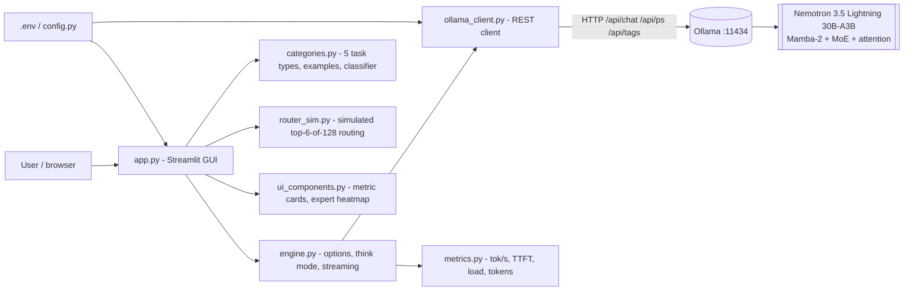
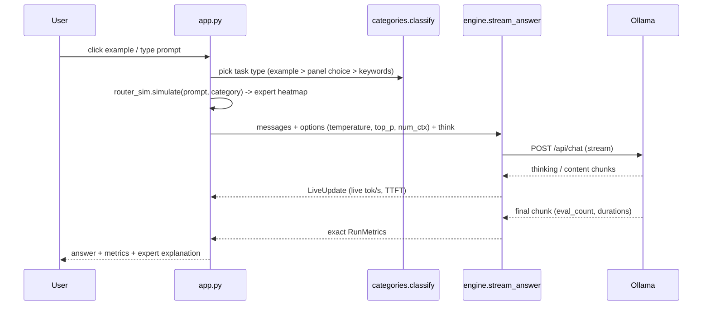
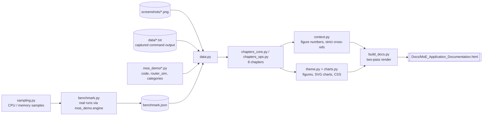

# Architecture

The app is a local Streamlit GUI. All inference runs in the local Ollama server; nothing leaves the machine.

## Request flow

## Measured vs. illustrative

| Data | Origin |
|---|---|
| Connection state, loaded model, memory, context | Ollama `/api/version`, `/api/tags`, `/api/ps` (**measured**) |
| tokens/s, load time, token counts | Ollama final chunk (**measured**); TTFT and wall time by the app timer (**measured**) |
| Expert activation | `router_sim.py` (**illustrative**): Ollama does not expose router decisions. A deterministic top-6-of-128 simulation biased by per-category *expert affinity* in `categories.py`. Specialisation is soft, so several groups always share the work. |

## Modules

| File | Responsibility |
|---|---|
| `app.py` | Streamlit layout, session state, error display |
| `moe_demo/ollama_client.py` | REST client, typed errors (offline, model missing, timeout) |
| `moe_demo/engine.py` | Parameter validation, reasoning mode, message building, streaming + live metrics |
| `moe_demo/metrics.py` | Convert Ollama timings (ns) to tok/s etc. |
| `moe_demo/categories.py` | Task types, examples, system prompts, keyword classifier |
| `moe_demo/router_sim.py` | Deterministic MoE routing simulation |
| `moe_demo/ui_components.py` | HTML renderers (escaped) |
| `moe_demo/help_text.py` | Tooltips and in-app MoE guide |
| `tests/` | Unit tests incl. a stub Ollama HTTP server and Streamlit `AppTest` smoke tests |
| `docs_tools/` | Generator for `Docs/MoE_Application_Documentation.html` (see below); not imported by the app |

## Documentation generator

`docs_tools` turns measurements, captures and the live source code into one self-contained HTML page. It reads the
app packages but the app never imports it.

Nothing in the page is typed in by hand if it can be derived: line counts, test counts, code listings, simulated
shares and benchmark figures all come from the sources above. `scripts/capture_evidence.sh` regenerates the
terminal captures (pytest with coverage, test-gate, project-audit, secret scan, git-hygiene) and rebuilds the page.
