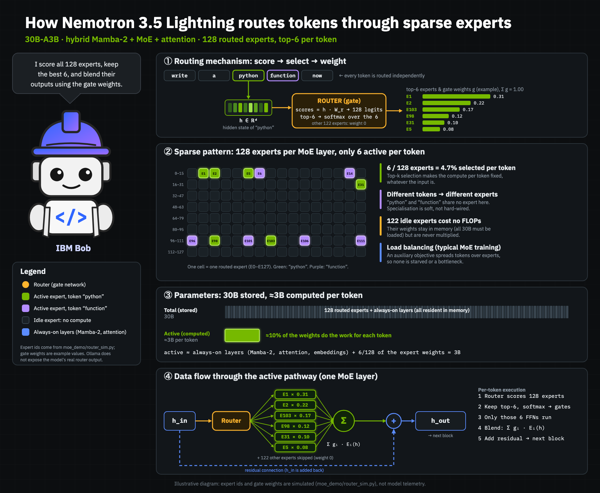

# Token routing in Nemotron 3.5 Lightning



> **Honesty note.** The diagram is illustrative. Ollama does not expose the model's real router decisions,
> so the expert ids come from the project's deterministic simulator ([`moe_demo/router_sim.py`](../moe_demo/router_sim.py))
> and the gate weights are example values. The architecture facts (30B parameters, ~3B active per token,
> 128 routed experts, top-6, hybrid Mamba-2 + MoE + attention) are the ones stated in the model card as
> summarised in the [README](../README.md).

Regenerate the figure with `python -m docs_tools.routing_diagram` (writes `Docs/images/token-routing.svg`).

## 1. Routing mechanism: score → select → weight

Every MoE layer holds 128 routed expert networks (small feed-forward blocks) and a small **router** (gate).
For each token independently:

1. The layer receives the token's hidden state `h ∈ ℝᵈ`.
2. The router computes one score per expert: `logits = h · W_r` (128 numbers).
3. **Top-k selection**: the 6 highest scores are kept; the other 122 experts get weight 0.
4. A **softmax over the 6 kept scores** gives the gate weights `g₁ … g₆`, which sum to 1.

```text
logits  = h @ W_r                 # shape: [128]
top_idx = topk(logits, k=6)       # 6 expert ids
g       = softmax(logits[top_idx])
```

## 2. The sparse MoE pattern

For one token, only 6 of 128 experts (4.7%) are selected. A different token selects a different subset
(in the figure, `python` and `function` share no expert). Specialisation is *soft*: experts tend to
favour certain kinds of input, but there is no hard-wired "code expert". MoE training typically adds a
load-balancing objective so that tokens spread over experts and none becomes a bottleneck.

The 122 unselected experts cost **no FLOPs** for that token. Their weights still have to be resident in
memory, which is why a 30B model still needs the memory of a 30B model (about 19 GB for the MLX build used
here) even though it computes like a ~3B one.

## 3. 30B stored, ≈3B computed

| | Parameters | Role |
|---|---|---|
| Total stored | ~30B | all 128 experts + always-on layers |
| Active per token | ~3B (≈10%) | always-on layers (Mamba-2, attention, embeddings) + 6/128 of the expert weights |

Because only about a tenth of the weights take part in each token's forward pass, per-token compute and
memory bandwidth resemble a ~3B dense model, while the pool of knowledge the model can draw on resembles
a 30B model. The exact split between always-on and expert parameters is not given in the sources used
here, so the figure does not claim one.

## 4. Data flow through the active pathway

For one MoE layer and one token:

1. `h_in` enters the router (gold) and the selected experts.
2. The router sends `h` to the 6 chosen experts only; they run in parallel.
3. Each expert returns `Eᵢ(h)`.
4. The outputs are blended: `y = Σ gᵢ · Eᵢ(h)`.
5. The residual connection adds `h_in` back: `h_out = h_in + y`, which goes to the next block of the hybrid
   stack (Mamba-2, attention or another MoE layer).

## 5. Why this gives high capacity with fast execution

- **Capacity** grows with the *total* number of experts: more experts means more specialised knowledge.
- **Speed** depends on the *active* number of experts (k = 6), which is fixed per token.
- Decoupling the two lets the model scale capacity without scaling per-token latency. The price is memory
  (all experts loaded) and routing overhead (load balancing, expert-parallel communication on multi-GPU setups).
