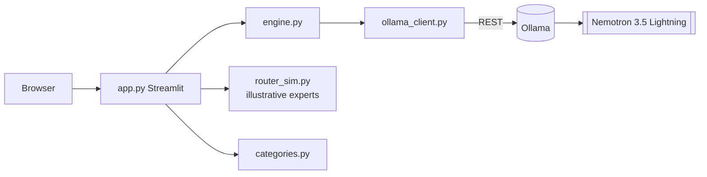
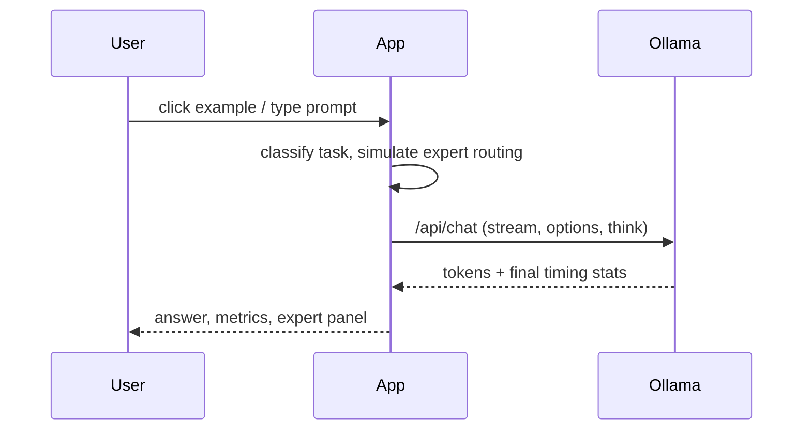

# Nemotron 3.5 Lightning MoE Explorer

A local, offline-capable Streamlit GUI that demonstrates the **Mixture-of-Experts (MoE)** design of
**NVIDIA Nemotron 3.5 Lightning 30B-A3B** (30B parameters, ~3B active per token, 6 of 128 experts,
hybrid Mamba-2 + MoE + attention) running through **Ollama** (`nemotron-3.5-lightning:30b-a3b-mlx`).

## Features
* Five task types – creative writing, coding, factual Q&A, analytical reasoning, summarization – each with
  three one-click examples and an explanation of which expert groups are likely involved.
* Live **measured** metrics: model load state, tokens/s, time to first token, response time, load time,
  prompt/generated tokens, reasoning share.
* Streaming chat with history, reasoning-trace viewer, and graceful errors (Ollama offline, model missing,
  timeouts, token limit hit).
* Sidebar controls with real effect on the next request: temperature, top-p, context window, max tokens,
  reasoning mode; load/unload the model.
* Tooltips, help panel and an MoE guide tab.

> **Honesty note:** Ollama does not expose the router's per-token expert choices. The expert heat-map is a
> clearly labelled, deterministic *simulation* guided by each task's expert affinity. Everything else shown
> (speed, latency, token counts, load state) is measured.

## Architecture



## Workflow



## Quick start

```bash
ollama pull nemotron-3.5-lightning:30b-a3b-mlx
cp .env.example .env
bash .bob/skills/python-env/scripts/setup_env.sh .
scripts/start.sh        # prints the URL (http://localhost:8501)
```

Details: [Docs/Quickstart.md](Docs/Quickstart.md) · Design: [Docs/Architecture.md](Docs/Architecture.md) ·
Token routing explained: [Docs/Token-Routing.md](Docs/Token-Routing.md).
Dependencies: [requirements.txt](requirements.txt) (`streamlit`, `requests`); tests and documentation build:
[requirements-dev.txt](requirements-dev.txt) (`pytest`, `pytest-cov`, `pillow`).

## Full documentation

[`Docs/MoE_Application_Documentation.html`](Docs/MoE_Application_Documentation.html) is a single, self-contained
page (open it in any browser, no server needed) with eight chapters: architecture, GUI, engine and Ollama
integration, expert system, testing, deployment, performance metrics and troubleshooting. It contains 43 figures:
real screenshots of the running app with numbered pins, block diagrams, verbatim terminal captures, and charts
drawn from a real benchmark (`Docs/assets/data/benchmark.json`). Expert routing is labelled as a simulation
there too; speeds and latencies are measurements from the benchmark host named on its cover.

Rebuild it after changing the app (the benchmark re-runs the 15 examples against your local model and takes several minutes, longer on a cold start):

```bash
.venv/bin/python -m docs_tools.benchmark        # optional: refresh the measurements (needs Ollama + model)
scripts/capture_evidence.sh                     # re-capture test/audit output and rebuild the HTML
# or only rebuild the page from the existing captures:
.venv/bin/python -m docs_tools.build_docs
```

## License

This application is released under the **MIT** license.
The Nemotron model is distributed by NVIDIA under its own terms (NVIDIA Open Model Agreement / OpenMDW as
shown by `ollama show`); review them before redistributing the model.
